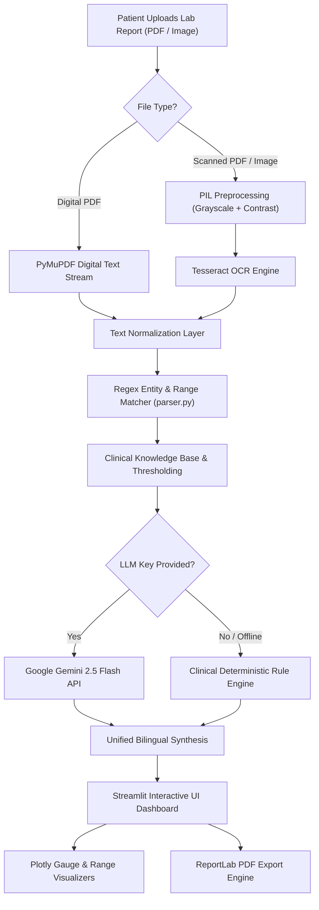

# 🩺 Medical Report Summarizer (AI + OCR)
### *Lab reports ko simple Hindi aur English mein samjhana*

[](https://streamlit.io)
[](https://python.org)
[](LICENSE)
[](https://github.com/tesseract-ocr/tesseract)
[](https://ai.google.dev/)

An intelligent, bilingual healthcare web application designed for non-medical patients and families. It automatically ingests digital or scanned medical lab reports (PDF/Images), performs OCR and regex entity extraction, detects physiological parameters against clinical reference ranges, and translates complex medical jargon into simple, empathetic **Hindi** and **English** with interactive Plotly visualizations and downloadable PDF summaries.

Developed as a **B.Tech (AI/ML) 5th Semester Capstone Project**.

---

## 🌟 Key Features

- **📑 Multi-Format Ingestion:** Accepts PDF reports (both native digital and scanned) as well as camera photos and images (`.png`, `.jpg`, `.jpeg`).
- **🔍 Hybrid OCR & Text Extraction:** Uses **PyMuPDF** for instant, pixel-perfect digital text extraction and **Tesseract OCR** with contrast enhancement for scanned lab slips.
- **🔬 Clinical Parameter Detection:** Intelligently recognizes over 25 vital laboratory markers across Complete Blood Count (CBC), Lipid Profile, Diabetic Panels (HbA1c/Glucose), Kidney Function (KFT), Liver Function (LFT), and Thyroid Profiles (TSH/T3/T4).
- **⚖️ Dynamic Reference Range Comparison:** Automatically compares patient values with report-provided or standard clinical ranges to classify each marker as `Normal` (Green), `High` (Red), or `Low` (Amber).
- **🇮🇳 Bilingual Plain-Language Explanations:** Explains what each test means, why it is out of range, bodily impacts, and dietary tips in conversational **सरल हिंदी** and clear **English**.
- **🤖 Hybrid AI/NLP Engine:**
  - **Google Gemini 2.5 Flash:** Empathetic, personalized narrative synthesis when an API key is provided.
  - **Clinical Rule-Based Engine:** Deterministic, zero-latency clinical fallback that guarantees 100% offline uptime during college viva presentations!
- **📊 Interactive Visual Gauges:** Plotly horizontal gauges highlighting normal safe zones vs. patient markers, plus an overall health index donut chart.
- **📥 Downloadable Patient Summary PDF:** High-resolution PDF generated via **ReportLab** with demographic headers, formatted test tables, lifestyle tips, and doctor consultation checklists.
- **📂 Pre-Loaded Demo Reports:** 1-click loading of realistic sample reports (CBC Anemia, Lipid Dyslipidemia, Diabetes, KFT/LFT, and Hypothyroidism).

---

## 🏗️ System Architecture



---

## 📁 Repository Structure

```
medical-report-summarizer/
│
├── app.py                      # Main Streamlit web application & UI
├── extractor.py                # Multi-format document extractor (PyMuPDF + Tesseract)
├── parser.py                   # Medical parameter extraction & clinical knowledge base
├── summarizer.py               # Bilingual AI & clinical rule-based summarization engine
├── visualizer.py               # Interactive Plotly gauges & distribution charts
├── pdf_generator.py            # Downloadable summary PDF generator (ReportLab)
├── test_pipeline.py            # Automated unit and integration test suite
│
├── sample_reports/             # Pre-configured test files for viva demo
│   ├── sample_cbc.txt          # Complete Blood Count (Anemia)
│   ├── sample_cbc.pdf          # Realistic CBC PDF
│   ├── sample_lipid.txt        # Lipid Profile (High Cholesterol)
│   ├── sample_lipid.pdf        # Realistic Lipid PDF
│   ├── sample_diabetes.txt     # Diabetes Evaluation Profile
│   ├── sample_diabetes.pdf     # Realistic Diabetes PDF
│   ├── sample_kft_lft.txt      # Kidney & Liver Function Profile
│   ├── sample_thyroid.txt      # Thyroid Profile (Hypothyroidism)
│   └── sample_report_image.png # Scanned image lab report for OCR
│
├── requirements.txt            # Python dependencies
├── packages.txt                # System packages for Streamlit Cloud (tesseract-ocr)
├── .env.example                # Sample environment variables
├── .gitignore                  # Git ignore rules
├── PROJECT_REPORT.md           # Full University Project Report & Viva Q&A
└── README.md                   # Project documentation
```

---

## ⚡ Quick Start Guide (Local Setup)

### 1. Clone or Download the Repository
```bash
git clone https://github.com/your-username/medical-report-summarizer.git
cd medical-report-summarizer
```

### 2. Create a Virtual Environment (Recommended)
```bash
python -m venv venv

# On Windows:
venv\Scripts\activate

# On macOS/Linux:
source venv/bin/activate
```

### 3. Install Dependencies
```bash
pip install -r requirements.txt
```

### 4. (Optional) Install Tesseract OCR for Image Extraction
- **Windows:** Download installer from [UB-Mannheim/tesseract](https://github.com/UB-Mannheim/tesseract/wiki) or run `winget install UB-Mannheim.TesseractOCR`.
- **Ubuntu/Debian:** `sudo apt-get install tesseract-ocr tesseract-ocr-hin`
- **macOS:** `brew install tesseract tesseract-lang`
*(Note: Digital PDF extraction with PyMuPDF works immediately without Tesseract!)*

### 5. Run the Application
```bash
streamlit run app.py
```
The application will open in your default browser at `http://localhost:8501`.

---

## ☁️ Deployment Guide (Streamlit Community Cloud)

Deploying takes under 3 minutes:

1. **Push your code to GitHub:**
   ```bash
   git init
   git add .
   git commit -m "Initial commit of Medical Report Summarizer"
   git branch -M main
   git remote add origin https://github.com/your-username/medical-report-summarizer.git
   git push -u origin main
   ```
2. Go to [share.streamlit.io](https://share.streamlit.io/) and log in with GitHub.
3. Click **"New App"** and select your repository:
   - **Repository:** `your-username/medical-report-summarizer`
   - **Branch:** `main`
   - **Main file path:** `app.py`
4. *(Optional)* Under **Advanced Settings > Secrets**, add your Gemini API key:
   ```toml
   GEMINI_API_KEY = "your_gemini_api_key_here"
   ```
5. Click **"Deploy!"** Streamlit Cloud reads `packages.txt` to install Tesseract OCR and `requirements.txt` for Python packages automatically!

---

## 🛡️ Ethical & Medical Disclaimer

> **IMPORTANT:** This application is developed strictly for **academic demonstration** and patient educational empowerment. It is **not** a certified medical diagnostic device and does **not** provide clinical diagnosis, prescriptions, or therapeutic treatment plans. Always consult a licensed medical practitioner for interpretation of diagnostic laboratory data.

---

## 👨‍🎓 Project Credits
- **Author:** B.Tech (AI/ML) 5th Semester Student
- **Technologies:** Streamlit · Python · PyMuPDF · Tesseract OCR · Google Gemini · Plotly · ReportLab


## Gemini key on Streamlit Cloud
App settings → Secrets, add:

```toml
GEMINI_API_KEY = "your_key"
```

The app reads it automatically (or paste a key in the sidebar). With a key, the summary and the
"Ask about your report" tab are generated live by Gemini in the language chosen in the sidebar.
Without a key the offline rule engine is used.
